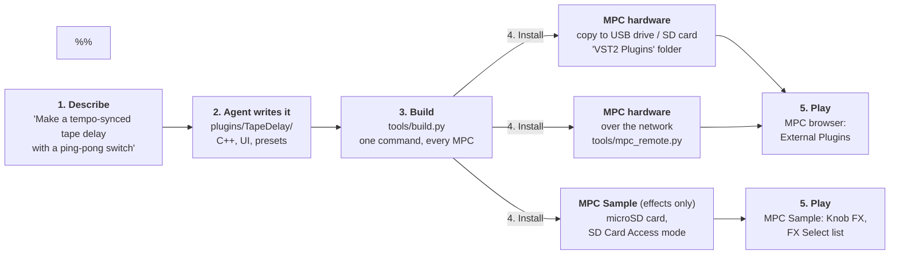

MPC Plugin SDK
==============

This SDK allows you to build instrument and effect plugins for Akai MPC standalone hardware from a plain-language description using an AI coding agent, and install it directly onto your MPC. It writes C++ that you never have to read if you do not want to.

The plugins can run on MPC X, X SE, Live, Live II, One, One+, Key 61, Key 37, Force (32-bit) and MPC Live III, MPC XL and later (64-bit). Effects also run on the **MPC Sample** (64-bit) as Knob FX.

**Plugin support requires MPC OS 3.10.1 or later, with the External Plugin Support feature enabled on the device**: Preferences → Enhancements (Beta) → turn on *Enable Enhancements* and *External Plugin Support*.

**MPC Sample**: firmware v1.4.0 or later; in *MIDI Config* turn on *Dev Enhancements (Beta)* and *Custom Plug-In Support*, then copy plugins to `VST2 Plugins` on its microSD card through *SD Card Access* mode. It loads effect plugins only, not instruments, and has no plugin screen: each effect exposes 6 parameters on its knobs (3, plus 3 more while holding SHIFT), set in `plugin.json`. See [docs/knob-fx.md](docs/knob-fx.md).

Each step is explained, with a larger diagram, in **[docs/workflow.md](docs/workflow.md)**.

## Start here

- See **[GETTING_STARTED.md](GETTING_STARTED.md)**: clone this repo, build an example, put it on your MPC, then describe your own plugin.
- Point Claude Code or Codex at this folder. `AGENTS.md` and the skills in `.claude/skills/` / `.agents/skills/` teach the agent the whole workflow.

## Example prompts

Paste one of these prompts into your agent with the SDK folder open:

> Create an MPC instrument called "Dune Bass": a monophonic bass synth with saw and square oscillators, sub oscillator, a resonant low-pass filter with envelope amount, glide, and a drive stage. Put oscillator controls on page one and filter/envelope on page two. Add 8 presets ranging from clean sub to aggressive acid. When built, install it on my MPC and restart the device so plugins are rescanned.

> Build an MPC effect called "Shimmer": a reverb with an octave-up pitch-shifted feedback path, pre-delay, damping, size, mix. Keep CPU low enough for two instances on an MPC Live II.

> Make an MPC drum synth with 8 voices on notes 36–43 (kick, snare, rim, clap, closed hat, open hat, tom, perc). Each voice has tune, decay and level. Kick and snare go to the main stereo output, everything else to a second stereo output. One page per pair of drums.

> I want a generative melody instrument: while the MPC plays, it picks notes from a selectable scale on every 8th or 16th note (density control), with octave range and rest probability, played through a simple FM pluck with decay and brightness controls.

> Port the DSP from this open-source filter I pasted into an MPC effect with cutoff, resonance, drive and mode (LP/BP/HP) controls. Credit the original author and licence in the README.

> My plugin "Dune Bass" makes a click when I load a project. Find out why and fix it. When you're done, update the plugin on my MPC.

## What is in the box

| Folder | Contents |
|---|---|
| `framework/` | `mpc_plugin.h`: header-only plugin framework (parameters, MIDI, transport, state, programs). `mpc_vst2_abi.h`: clean-room description of the VST 2.4 binary interface. `dsp/`: oscillators, filters, envelopes, delay lines, LFOs, voice allocation, smoothing, tempo helpers. |
| `tools/` | `build.py` (one-command cross-compile for both MPC CPU families + native), `host-sim/` (a command-line host that behaves like the MPC for testing on your computer), `validate.py`, `gen_ui.py`, `package.py`, `mpc_remote.py` (install and manage plugins on an MPC over the network), `new_plugin.py`, `make_ui_kit.py` (film-strip knobs, faders, switches), `make_knob.py`, `docker/`. |
| `examples/` | `SimpleSynth` (8-voice subtractive synth with presets), `StereoDelay` (tempo-synced effect), `DrumSynth` (multi-output drum instrument). Complete projects you can build and copy. |
| `templates/` | Minimal instrument and effect projects used by `new_plugin.py`. |
| `docs/` | The [workflow](docs/workflow.md) from idea to installed plugin, the [supported MPCs](docs/supported-devices.md) and how they differ, and the specifications: plugin folder and `plugin.json`, the host contract, MPC Sample Knob FX (`knob-fx.md`), the scripted UI JSON system (`ui-reference.md`), building, testing, presets, troubleshooting, FAQ and legal notes, and the [changelog](docs/changelog.md). |
| `ui-kit/` | Stylish unipolar/bipolar film-strip knobs and faders plus matching switches, in several colour themes. `ui.json` uses them through the `knob`, `fader` and `switch` widgets. |
| `schemas/` | JSON Schemas for `plugin.json` and `ui.json`. |
| `.claude/skills/`, `.agents/skills/` | Agent skills: new, dsp, ui, build, test, package, presets, deploy (install on an MPC over the network), troubleshoot. |

## Requirements

- Python 3.9 or newer. Everything else (the Zig cross compiler) is fetched on first build, or use your own GNU cross compilers / Docker (`docs/building.md`).
- macOS, Windows or Linux.
- An MPC running MPC OS 3.10.1 or later, with External Plugin Support enabled in Preferences → Enhancements (Beta), plus a USB drive or SD card; or an MPC Sample running firmware v1.4.0 or later with Custom Plug-In Support on (effects only), a microSD card and a USB cable.

## How it works, briefly

An MPC plugin is a Linux shared library following the VST 2.4 binary interface, in a folder with a `plugin.json` manifest and optional JSON "skins" for the touch screen and the 16 hardware knobs. The MPC loads it in-process; there are no plugin windows, so the UI is data. The SDK framework hides the binary interface behind a small C++ class: declare parameters, implement `process()`, done. `docs/overview.md` has the full picture.

## Safety

Third-party plugins run inside the MPC application without protection. A bug can freeze or restart the MPC. Test with the host simulator first, save your work often, and remove a misbehaving plugin's folder from the drive to recover. inMusic does not test or support third-party plugins.

## What's new

New features and fixes are described in the SDK [changelog](docs/changelog.md).

## Licence

MIT. Contains no Steinberg VST SDK code. "VST" is a trademark of Steinberg Media Technologies GmbH. See `LICENSE` and `docs/faq-and-legal.md`.
