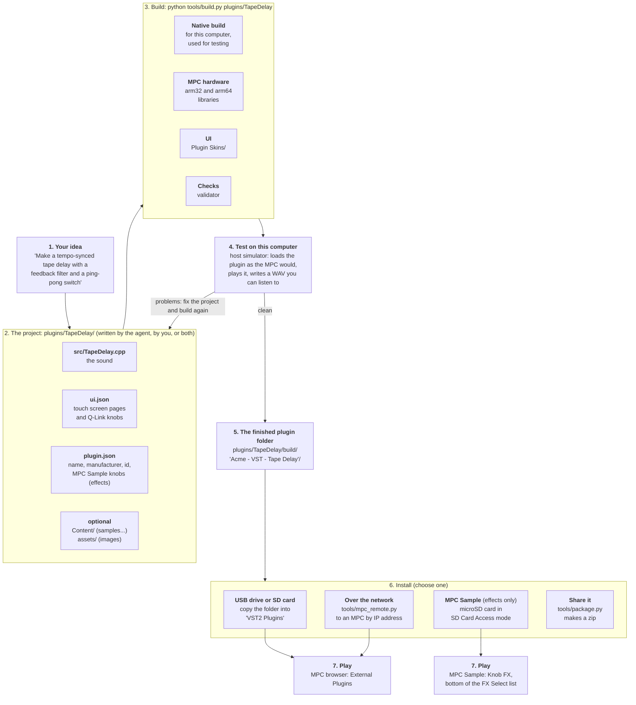

# The workflow: from an idea to a plugin on your MPC

This page follows one plugin from an idea to a sound you play.

There are two ways to work, and you can mix them freely:

- **With an AI agent** (Claude Code or Codex). You describe the plugin in plain language; the agent writes the code and runs every command on this page for you. You never have to read the C++.
- **By hand.** If you are a developer, write the C++ and the UI yourself and run the same commands. The project is ordinary source files and the tools are ordinary Python scripts; nothing depends on an agent.

Both ways use the same project, the same build and the same install steps. A common mix is to let the agent write a first version and then edit the code yourself, or to write the DSP yourself and ask the agent for the UI and presets.

The example is a delay effect called "Tape Delay" by a manufacturer called "Acme". Because it is an effect, it also runs on the **MPC Sample** as a Knob FX; instruments do not. The MPC Sample differs in a few places (no touch screen UI, its own install route), noted in each step and described fully in [knob-fx.md](knob-fx.md).

## The whole picture



## 1. Your idea

**With an agent:** open the SDK folder in Claude Code or Codex and describe the plugin in plain language: what it is (instrument or effect), what controls it has, how they are arranged on pages, any presets. The README has example prompts. The agent asks for your manufacturer name if you have not given one, because it becomes part of the plugin's identity.

**By hand:** create an empty project from a template, then fill it in:

```
python tools/new_plugin.py "Tape Delay" --vendor "Acme" --kind effect
```

## 2. The project

Either way, the result is a project folder in `plugins/`. This folder is the source of your plugin; keep it (and back it up).

```
plugins/TapeDelay/
├── plugin.json             what the plugin is: name, manufacturer, unique id, instrument or effect;
│                           for an effect, also its MPC Sample Knob FX mapping (3 knobs + 3 with SHIFT)
├── src/TapeDelay.cpp       the sound, in C++ (read and edit it, or leave it to the agent)
├── ui.json                 the touch screen pages and which control each Q-Link knob moves
├── README.md               what the plugin does and its controls
├── Content/                optional: samples, wavetables and other files the plugin loads
└── assets/                 optional: your own images for the UI (page backgrounds, knobs)
```

An effect's `plugin.json` names the six parameters the MPC Sample's knobs control (`shortName`, `knobs`, `shiftKnobs`). On the MPC Sample those six are the plugin's entire UI, since it has no plugin screen and does not use `ui.json`, and the mapping is as permanent as the plugin's id. See [knob-fx.md](knob-fx.md).

To change the plugin later, ask the agent ("add a high-pass filter", "move Feedback to page two") or edit these files yourself, then build again.

If you write the code yourself: the plugin is one C++ class built on the header-only framework in `framework/mpc_plugin.h`. You declare parameters and implement `process()`; the framework handles the plugin binary interface. `framework/dsp/` has ready-made oscillators, filters, envelopes and delay lines, and `examples/` has complete plugins to copy from. The rules that matter on the MPC (no allocation or file access in `process()`, identity that must never change) are under "Hard rules" in `AGENTS.md`, which is as useful to a person as it is to an agent.

Details: [overview.md](overview.md) for the mental model, [dsp-cookbook.md](dsp-cookbook.md) for the sound, [ui-guide.md](ui-guide.md) for the UI, [presets.md](presets.md) for presets.

## 3. Build

One command turns the project into a plugin for every MPC:

```
python tools/build.py plugins/TapeDelay
```

It does these things in order:

1. **Native build.** Compiles the plugin for your own computer and loads it in the host simulator to read its parameter list.
2. **MPC hardware builds.** Cross-compiles two libraries: `arm32` (MPC X, X SE, Live, Live II, One, One+, Key 61, Key 37, Force) and `arm64` (MPC Live III, MPC XL and later).
3. **UI.** Turns `ui.json` into the MPC's skin files (`Plugin Skins/`) and copies the images they use.
4. **Content.** Copies `Content/`.
5. **Checks.** Runs the validator, which catches mistakes that would make the MPC ignore the plugin or show the wrong UI. For an effect it also checks and prints the MPC Sample Knob FX mapping, one line per knob.

The first build downloads the compiler (Zig, about 50 MB). Nothing else needs installing.

Details: [building.md](building.md).

## 4. Test on this computer

Before anything goes near an MPC, run the plugin in the **host simulator** (the agent does this for you after every build), a small program that treats the plugin the way the MPC does:

```
.sdk-tools/host_sim plugins/TapeDelay/build/native/tape-delay.dylib test --wav plugins/TapeDelay/build/test.wav
```

It loads the plugin, plays notes or audio through it, saves and restores its state, sweeps every parameter, and writes a WAV file you can listen to. It reports crashes, bad audio, clipping, silence and high CPU use. If anything fails, fix the project (or let the agent fix it) and build again.

This matters because a plugin runs inside the MPC without protection: a bug can freeze or restart the MPC.

Details: [install-and-test.md](install-and-test.md).

## 5. The finished plugin folder

The build output is one self-contained folder. This folder, and nothing else, is what gets installed:

```
plugins/TapeDelay/build/Acme - VST - Tape Delay/
├── plugin.json                 tells the MPC what the plugin is and where its libraries are
├── version.xml
├── VST/
│   ├── tape-delay-arm32.so     32-bit MPC hardware
│   └── tape-delay-arm64.so     64-bit MPC hardware
├── Plugin Skins/               the touch screen UI and Q-Link mapping (TUI.json, Q-Links.json, images)
└── Content/                    only if the project has content
```

The same folder works on every MPC: each one picks the library it needs and ignores the other. The MPC Sample (effects only) loads the 64-bit library and ignores `Plugin Skins/`.

Details: [plugin-folder-format.md](plugin-folder-format.md).

## 6. Install

Run the command yourself, or ask the agent; it always asks before it installs anything. There are two ways to put a plugin on an MPC, one way to put an effect on an MPC Sample, and one way to share it.

| Where | How | What you need |
|---|---|---|
| **MPC hardware, from a drive** | Copy the finished folder into a folder named exactly `VST2 Plugins` at the root of a USB drive or SD card, and insert it in the MPC. | Nothing extra. |
| **MPC hardware, over the network** | `python tools/mpc_remote.py <MPC IP address> add plugins/TapeDelay`, or tell the agent "install this on my MPC at 192.168.1.50". | The MPC on the same network as your computer, with developer mode on (see [install-and-test.md](install-and-test.md)). |
| **MPC Sample (effects only)** | Put the MPC Sample in **SD Card Access** mode (from the Project screen) so its microSD card appears on the computer, copy the finished folder into `VST2 Plugins` on the card, eject the card on the computer, then leave SD Card Access mode. Or ask the agent to do the copy. Steps in [knob-fx.md](knob-fx.md). | A microSD card in the MPC Sample and a USB cable. Not installed over the network. |
| **Share with other people** | `python tools/package.py plugins/TapeDelay` makes a zip in `plugins/TapeDelay/dist/`. | Nothing extra. |

One-time setup on MPC hardware: MPC OS 3.10.1 or later, and **Preferences → Enhancements (Beta)** → turn on **Enable Enhancements** and **External Plugin Support**.

One-time setup on an MPC Sample: firmware v1.4.0 or later, and in **MIDI Config**, in the **Dev Enhancements (Beta)** section, turn on **Dev Enhancements (Beta)** and then **Custom Plug-In Support**.

## 7. Play

On the MPC, open the plugin browser; the plugin is listed under **External Plugins**. Instruments load as plugin programs, effects as inserts.

On an MPC Sample, the effect is a Knob FX at the bottom of the **FX Select** list. The three knobs control the first three mapped parameters, and the other three while SHIFT is held.

After you update a plugin that a project already uses, remove it from the track and add it again.

If the plugin does not appear, or something sounds or looks wrong, read [troubleshooting.md](troubleshooting.md), or tell the agent what you see.
